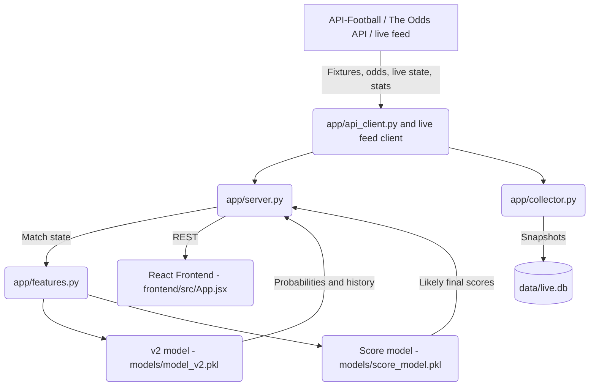

# Live Football Prediction Model

A full-stack machine learning app that predicts football matches while they are being played. For every live match it gives the chance of a home win, a draw or an away win, how that chance has moved since kick-off, and the most likely final scores. Predictions start from the pre-match betting odds and update on the score, cards, shots, shots on target and corners. A dark-themed React app shows it all.

## 🆕 What's New in v2

- **Model v2**: live shots, shots on target and corners now adjust the prediction. v2 beats v1 on the holdout (log-loss 0.678 vs 0.684), with lower log-loss in every 15-minute bucket.
- **Predictions without odds**: matches in leagues with no betting market now get live predictions too.
- **Likely final score**: a new model predicts how many more goals each side will score and shows the most likely final scorelines.
- **Full probability chart for every match**: the history is rebuilt from the goal and card timeline, so the chart covers the whole match even if nobody had the page open.
- **Redesigned UI**: dark theme with a pitch background.
  - The home screen shows only score, time and status.
  - The match page has win probability with the change since the pre-match market, a chart with goal markers, Likely final score, and team stats with the better number highlighted.
- **More reliable live data**: a backup live source (API-Football's free plan) and the opening pre-match line read during the match. Matches that finished since the daily fixture download now show as full time.
- **Fixes**: today's matches now follow your local day instead of the UTC day, so live games no longer go missing.
- **Lighter on APIs**: the open match refreshes every 8 minutes, detailed stats are fetched only for the match you open, and requests are spaced out and cached.

---

## 🏗 System Architecture

The project has five parts:

### 1. Data Collection (`app/collector.py` & `app/api_client.py`)
An unattended worker that fetches fixtures, match statistics and pre-match odds from **API-Football** and **The Odds API**.
- Polls live matches and tracks their event streams.
- Turns events into minute-by-minute snapshot rows that follow the same timing rules as the training data.
- Saves raw and minute-by-minute data to SQLite (`data/live.db`), building a dataset for future retraining.

### 2. Machine Learning Models (`training/` → `models/`)

| Model | Script | Output | Predicts |
|---|---|---|---|
| v1 | `training/train.py` | `models/model.pkl` | Home / Draw / Away from minute, goals, cards and pre-match odds |
| **v2** (served) | `training/train_v2.py` | `models/model_v2.pkl` | Home / Draw / Away, also using live stats; works with or without odds |
| Final score | `training/train_score.py` | `models/score_model.pkl` | Goals each side still scores → most likely final scorelines |

**v1**: a `HistGradientBoostingClassifier` trained on `data/snapshots.csv`, a minute-by-minute dataset of about 95k historical matches.

**v2** is v1 plus a live-stats correction:
- **Base model**: v1 when the match has pre-match odds, otherwise a copy of v1 trained without the odds features, so leagues with no betting market still get predictions.
- **Correction**: a logistic regression on top of the base model's probabilities. It uses the difference in shots, shots on target and corners between the teams, both as is and scaled by the time remaining.
- **Training data**: a second dataset of about 7.5k matches with in-play stats (`datasets/new_data/Data`, one JSONL file per match, flattened into `data/snapshots_v2.csv`).
- **Why this design**: a gradient-boosted model trained on the new data alone overfit, because 7.5k matches is too few for trees. The small correction on top of v1 doesn't.

**Final score model**: two stages, one model per side.
- **Stage 1**: a Poisson gradient-boosted model trained on v1's 95k matches.
- **Stage 2**: a Poisson regression on the v2 dataset's true final scores, which include stoppage time, adding the same live stats.
- **Output**: the expected remaining goals become a grid of possible final scores, using independent Poisson distributions on top of the current score.

**Evaluation**: each script holds out the newest 15% of matches.

| Holdout | Metric | Result |
|---|---|---|
| Matches with odds | log-loss (lower is better) | **v2 0.678** vs v1 0.684; v2 is better in every 15-minute bucket |
| Matches without odds | log-loss | **v2 0.736** vs 0.750 for the no-odds base model; v1 can't predict these at all |
| Final score | exact-score negative log-likelihood | **2.108** vs 2.175 for a plain goal-rate baseline. Predicted draws 22.5% vs 21.5% actual |

### 3. Backend API (`app/server.py`)
A **Flask** server:
- `GET /api/fixtures` returns today's fixtures. The list is downloaded once a day, then the live score and minute are overlaid.
- `GET /api/live/<fixture_id>` returns:
  - the live state: score, minute and cards
  - v2's Home/Draw/Away probabilities
  - the change since the pre-match market
  - team stats
  - the most likely final scores
  - the probability history
- The probability history is **rebuilt from the match's goal and card timeline on every request**. Every match gets a full chart from kick-off, even if nobody had it open.
- If the main live feed is unavailable, API-Football's live endpoint is the backup.

### 4. Feature Pipeline (`app/features.py`)
This is the only place where match state becomes model features, for both training and serving. Every model is called through it: `build_features_v2`, `predict_v2`, `goals_to_come` and `scorelines`.

### 5. Frontend (`frontend/`)
A **React + Vite** app with a dark theme.
- **Home screen**: today's matches grouped by competition, with live matches first. It shows only score, time and status.
- **Match page**:
  - win probability with the change since the pre-match market
  - a probability-over-time chart with goal markers
  - a **Likely final score** panel
  - team stats, with the better number highlighted
- **Polling**: the match list refreshes every 10 minutes. The open match refreshes every 8 minutes. Detailed stats are only fetched for the match the user opens.

---
## 🏗 High-Level Architecture Diagram


---

## ✨ Key Features

- **Live win probabilities** that react to goals, cards, shots, shots on target and corners, starting from the pre-match odds.
- **Works without odds**: lower-league matches with no betting market still get predictions.
- **Likely final score**: the most likely scorelines, with their chances.
- **Full probability chart for every match**: rebuilt from the timeline, so nobody needs to keep a page open.
- **Light on APIs**: fixtures are cached daily, stats are fetched only for opened matches, and requests are spaced out and cached. This keeps usage within free tiers: 100 requests/day for API-Football and 500 requests/month for The Odds API.

---

## 🚀 Setup & Installation

### Prerequisites
- Python 3.9+
- Node.js 18+
- API keys:
  - **API_FOOTBALL_KEY** from [API-Football](https://www.api-football.com/) (the free plan works)
  - **ODDS_API_KEY** from [The Odds API](https://the-odds-api.com/)

```bash
# Windows
setx API_FOOTBALL_KEY "your_api_football_key"
setx ODDS_API_KEY "your_odds_api_key"

# Linux/Mac
export API_FOOTBALL_KEY="your_api_football_key"
export ODDS_API_KEY="your_odds_api_key"
```

### 1. Backend
```bash
pip install flask flask-cors scikit-learn scipy pandas numpy requests joblib curl_cffi
python app/server.py
```
The backend starts at `http://localhost:5000`. It needs `models/model_v2.pkl` and `models/score_model.pkl` (see Model Retraining).

### 2. Frontend
```bash
cd frontend
npm install
npm run dev
```
Open `http://localhost:5173`. To point the app at a different backend, set `VITE_API` (for example `VITE_API=http://myserver:5000/api npm run dev`).

---

## 🤖 Automating the Collector

To build your own historical dataset, schedule `app/collector.py` to run daily during match hours.

**Windows Task Scheduler example** (runs daily at 18:00):
```cmd
schtasks /create /tn "football-collector" /sc daily /st 18:00 /tr "python \"P:\Projects\live football prediction model\app\collector.py\""
```
*Set the API key environment variables at system level so Task Scheduler can see them.*

---

## 🧠 Model Retraining

Run the scripts in this order. Each one prints its holdout metrics before saving.

```bash
python training/train.py            # v1    -> models/model.pkl        (needs data/snapshots.csv)
python training/train_v2.py         # v2    -> models/model_v2.pkl     (needs v1 + datasets/new_data/Data)
python training/train_score.py      # score -> models/score_model.pkl  (needs both CSVs)
```
- `train_v2.py` flattens the JSONL files into `data/snapshots_v2.csv` on its first run. Pass `--rebuild` to redo it after adding matches.
- After evaluating on the holdout, each script retrains on all the data before saving.
- To use a custom CSV path for v1: `python training/train.py path/to/snapshots.csv`.

---

## 🛠 Technologies Used

- **Machine Learning**: `scikit-learn`, `scipy`, `pandas`, `numpy`, `joblib`
- **Backend API**: Python, Flask, `requests`, `curl_cffi`, SQLite
- **Frontend UI**: React, Vite
- **Data Providers**: API-Football, The Odds API

---
## Comparison With Google's Live Prediction


---

## 🤝 Contributing
Contributions, issues and feature requests are welcome! Feel free to check the issues page if you want to contribute.

---

## 📄 License
Distributed under the MIT License.

Created by Tinil K Benny
